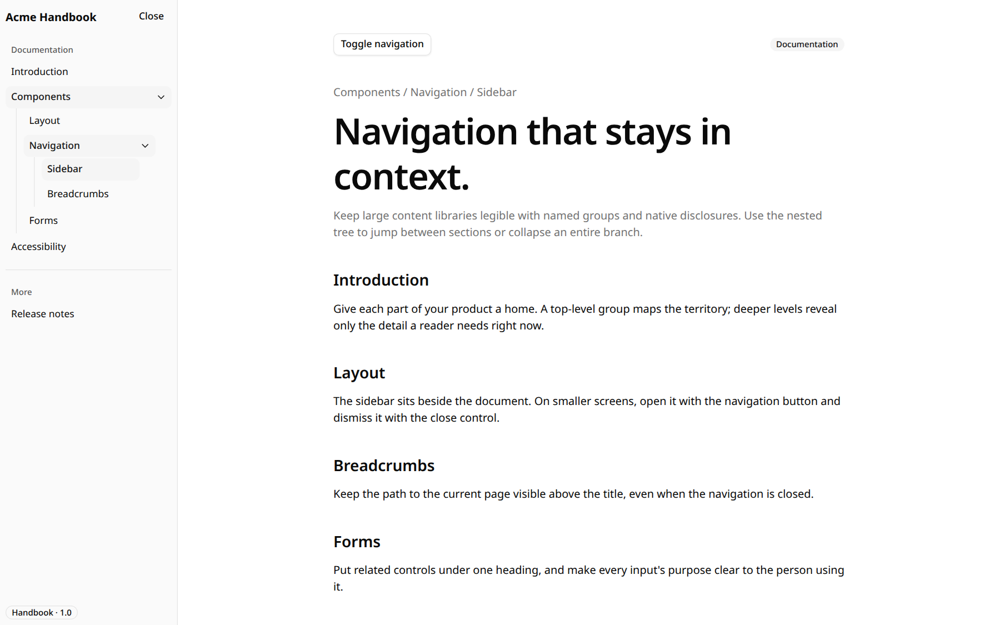

# Nested Sidebar — sidebar-03

A documentation navigation tree with native `
` submenus and a current article indicator.

<picture><source media="(prefers-color-scheme: dark)" srcset="./preview-dark.png"></picture>

**Basecoat components:** Sidebar, Button, Badge.

**Use:** Copy [`block.html`](./block.html) into a document loading Tailwind CSS 4, Basecoat 1.2.1 and Basecoat's `all.min.js`,. Preserve the sidebar ID, direct `<aside>` / `<main>` sibling relationship, unique submenu IDs, and `aria-current="page"` on the active link. Connect anchors to your own documentation routes and update the expanded branch for the current page. Native `
` provides keyboard disclosure; Basecoat manages the responsive sidebar overlay. No framework required.

**Design rationale:** Named groups and progressive disclosure keep deep libraries scannable without hiding the active path. The article makes the navigation example meaningful rather than displaying a blank stage.
